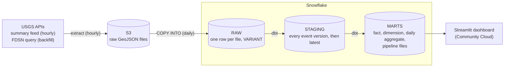

# USGS Earthquake Pipeline

[](https://github.com/mikestantonmusic/quake-pipeline/actions/workflows/ci.yml)

An ELT pipeline for [USGS earthquake data](https://earthquake.usgs.gov/earthquakes/feed/v1.0/geojson.php). Every hour it downloads the latest earthquakes to **S3**; once a day it loads them into **Snowflake**, where **dbt** turns them into tested tables. **Airflow** runs it all, and a **Streamlit** dashboard shows the results.

**Live dashboard: [quake-pipeline.streamlit.app](https://quake-pipeline.streamlit.app/)**

**Stack:** Python · Airflow 3 · Cosmos · dbt · Snowflake · AWS S3 · Streamlit Community Cloud · Docker Compose · GitHub Actions

Runs for about **$5 a month** (see [docs/costs.md](docs/costs.md)). The first, fully local version (Postgres instead of S3 and Snowflake) is tagged [`v1-local`](https://github.com/mikestantonmusic/quake-pipeline/tree/v1-local).

<!-- Screenshots: add docs/images/dashboard.png and docs/images/airflow-graph.png, then uncomment.


-->

## Highlights

- **Handles revisions and changed IDs.** USGS revises events after publishing them (new magnitudes, `automatic` → `reviewed`, deletions) and sometimes gives an event a new ID when a different network becomes its main source. Every version is kept; dbt keeps the latest, removes deleted events, and drops an ID once a newer event lists it as one of its own.
- **Idempotent end to end.** Snowflake's `COPY INTO` skips files it has already loaded, and dbt keeps one row per event version, so retries, overlapping hourly feeds and repeated backfills never create duplicates.
- **Cheap by design.** Extracting runs hourly but costs nothing in Snowflake; the warehouse starts once a day for the load and dbt. The dashboard runs two fixed queries that Snowflake answers from its result cache between loads.
- **Least privilege.** Airflow, Snowflake and the dashboard each have their own credentials. The dashboard's user can only read the marts schema.
- **Tested at every layer.** 78 pytest tests (API client, S3 storage, Snowflake loader, dashboard), 36 dbt data tests including reconciliation checks against raw, and CI on every push.
- **One Airflow task per dbt model** via Cosmos, so a failure points at the exact model and can be retried on its own.

## Architecture



| Part | Runs on |
|------|---------|
| Airflow (scheduler, web UI, its Postgres database) | Docker on a laptop |
| Raw files | AWS S3 (`us-east-2`) |
| Warehouse and dbt models | Snowflake, Standard edition, one X-Small warehouse |
| Dashboard | Streamlit Community Cloud, redeployed on every push |

Airflow runs on a laptop to stay within budget: a cloud server big enough for Airflow would cost more than everything else combined. When the laptop sleeps, nothing is downloaded, but each hourly download holds the past 24 hours, so gaps shorter than a day fill themselves (see [Running it day to day](#running-it-day-to-day)).

## Airflow DAGs

| DAG | Schedule | What it does |
|-----|----------|--------------|
| `quake_extract` | hourly | Downloads the `all_day` feed to S3. Doesn't touch Snowflake |
| `quake_transform` | daily, 06:00 UTC | Downloads the feed once more, `COPY INTO` the new files, then runs dbt |
| `quake_backfill` | manual | Downloads a date range from the FDSN API (one file per UTC day), then triggers `quake_transform` |
| `smoke_test` | manual | Checks Airflow can reach S3 and Snowflake and that dbt is installed |

```
quake_transform:  extract → load → transform (dbt, one task per model, each followed by its tests)

transform:  stg_earthquake_versions → stg_earthquakes ─┐
            region_aliases (seed) ─────────────────────┴→ fct_earthquakes → dim_region
                                                                          → agg_daily_by_region
            pipeline_files
```

To backfill, trigger `quake_backfill` with UTC dates (end exclusive):

```sh
docker compose exec airflow-scheduler airflow dags trigger quake_backfill --conf '{"start": "2026-10-01", "end": "2026-10-08"}'
```

Design decisions:

- **Extract hourly, load daily.** Snowflake bills the warehouse by the second with a 60-second minimum per start, so one load a day costs a twenty-fourth of hourly loads. The dashboard is up to a day behind in exchange.
- **A fresh download before each load.** `quake_transform` downloads the feed itself before `COPY INTO`, so a load always includes data from moments earlier, even when the laptop was asleep at 06:00 and the run starts late. If USGS is down, the load still runs with the files already in S3.
- **Thin DAGs.** Tasks call the same `ingestion` functions as the CLI; only small summaries pass between tasks (XCom), never the data.
- **dbt packages installed in the image**, so no task spends time on `dbt deps`. Tests use Cosmos's `BUILDABLE` selection, so a test that reads several models only runs once all of them are rebuilt. All dbt tasks share a one-slot pool, so two runs never build the same table at once.

## Loading into Snowflake

`ingestion/snowflake_load.py` runs one `COPY INTO` from an external stage on the bucket. Each GeoJSON file becomes one row in `raw.feed_files` (the whole document in a `VARIANT` column), and each file's result goes into `raw.load_audit`. Snowflake remembers which files it has loaded for 64 days, so running it again loads only new or changed files.

The stage reads S3 with the access keys of a read-only IAM user. The usual alternative, a storage integration that assumes an IAM role, is blocked in this AWS account by an AWS-managed policy; [infra/aws/README.md](infra/aws/README.md) explains why.

## Transforming with dbt

| Model | Grain | Purpose |
|-------|-------|---------|
| `staging.stg_earthquake_versions` | one row per event version | Incremental: flattens new files' features, keeps one row per `(event_id, updated_ms)` |
| `staging.stg_earthquakes` | one row per event | Latest version of each event, typed, with superseded IDs removed |
| `marts.fct_earthquakes` | one row per earthquake | Main table; excludes blasts and deleted events; adds `mag_class`, `depth_class`, `region` |
| `marts.dim_region` | one row per region | Lifetime stats per region |
| `marts.agg_daily_by_region` | one row per region per day | Daily counts and magnitudes |
| `marts.pipeline_files` | one row per file per load | Load status per file, for the dashboard's health page |

Design decisions:

- **Incremental with a lookback.** `stg_earthquake_versions` reads files loaded since its last run, minus 3 hours, and skips versions it already has, so a slow or overlapping load can't be missed.
- **Superseded IDs.** When USGS moves an event to a new ID, the new event's `ids` field lists the old one. An event is dropped if a newer event lists its ID.
- **Reconciliation tests.** Besides column tests, `tests/` checks that `fct_earthquakes` matches what raw says it should, that no superseded IDs remain, and that the daily aggregate adds up to the fact table.
- **`region` comes from `place`.** It's the text after the last comma, or the whole string when there's no comma ("Banda Sea"). The `region_aliases` seed expands codes like `CA` and `MX`.

To run dbt by hand, use the Airflow container, which has dbt and the credentials:

```sh
docker compose exec -w /opt/airflow/dbt/quake airflow-scheduler dbt build --profiles-dir .
```

## Dashboard

[quake-pipeline.streamlit.app](https://quake-pipeline.streamlit.app/) has two pages:

- **Earthquakes**: date, magnitude and region filters above stat tiles, a world map (dot size = magnitude, color = depth band), earthquakes per day, the magnitude distribution, the busiest regions and the strongest events with links to USGS.
- **Pipeline health**: freshness of the last load, hourly files before it, files loaded per day, failed files and warehouse totals.

| File | Role |
|------|------|
| `dashboard/queries.py` | The two SQL queries; no Streamlit or Snowflake imports, so it runs in tests |
| `dashboard/metrics.py` | Pure pandas: filters, KPIs, daily counts, histogram, freshness |
| `dashboard/charts.py` | Altair charts and the pydeck map, using a validated light/dark palette |
| `dashboard/db.py` | Snowflake connection (key-pair auth) and one-hour caching |
| `dashboard/views/` | The two pages, layout only |

It connects as `DASHBOARD_USER` with `REPORTER_ROLE`, which can read only `MARTS`. On Community Cloud the settings and private key are in the app's secrets; [dashboard/.streamlit/secrets.toml.example](dashboard/.streamlit/secrets.toml.example) shows the format. Filtering happens in pandas, not SQL, so every visit runs the same two queries and Snowflake can answer them from its result cache without starting the warehouse.

A local copy runs at http://localhost:8501 with `docker compose up -d`, handy for checking changes before pushing.

## Setup

Requires Docker Desktop, an AWS account, a Snowflake account and the AWS CLI.

1. **AWS:** create the bucket and two IAM users: [infra/aws/README.md](infra/aws/README.md).
2. **Snowflake:** in a Snowsight worksheet, run the scripts in [infra/snowflake/](infra/snowflake/) in order:
   - `01_account.sql`: warehouse, resource monitor, database, schemas, roles
   - `02_pipeline_user.sql`: the pipeline user
   - `03_s3_stage.sql`: the stage on the bucket
   - `04_dashboard_user.sql`: the dashboard user

   Each user signs in with a key pair. Keep the private keys in `secrets/snowflake/`, which git ignores.
3. **Local settings:** `cp .env.example .env` and fill in the AWS keys and Snowflake account.
4. **Start Airflow:**
   ```sh
   make up   # or: docker build -f docker/airflow/Dockerfile -t quake-pipeline/airflow:local . && docker compose up -d
   ```
   Then, at http://localhost:8080:
   1. Trigger `smoke_test`.
   2. Trigger `quake_backfill` for some history.
   3. Unpause `quake_extract` and `quake_transform`.
5. **Dashboard:** on [share.streamlit.io](https://share.streamlit.io), create an app from this repo with main file `dashboard/app.py`, Python 3.12, and the `[snowflake]` secrets.

## Local development

```sh
python -m venv .venv
.venv\Scripts\activate            # macOS/Linux: source .venv/bin/activate
pip install -r requirements-dev.txt
pre-commit install                # run the linters before every commit

pytest                            # no cloud access needed
ruff check .
sqlfluff lint dbt/quake/models dbt/quake/tests

# Download to a local folder (RAW_STORAGE=s3 or local,s3 uploads to the bucket instead)
python -m ingestion.extract feed --level all --period day
python -m ingestion.extract range --start 2026-10-01 --end 2026-10-02
```

Raw files are named after the window they cover, so re-running an extract overwrites rather than duplicates:

```
raw/feed/all_day/YYYY/MM/DD/<run time>.geojson
raw/fdsn/YYYY/MM/DD/<day start>_<day end>.geojson
```

The FDSN API returns at most 20,000 events per query, so `range` checks the count first and halves the window until each part fits.

## Testing and CI

Every push to `main` or `cloud`, and every pull request, runs three GitHub Actions jobs (`.github/workflows/ci.yml`). None needs cloud credentials:

| Job | What it checks |
|-----|----------------|
| Lint | `ruff` on Python, `sqlfluff` (Snowflake dialect) on the dbt SQL |
| Python tests | pytest, with S3 faked by `moto` and Snowflake by stand-in connections and canned query results |
| dbt parse | That every model, `ref()`, `source()` and YAML file in the Snowflake project is valid, without connecting to Snowflake |

`dbt parse` doesn't run the SQL. The data tests run against real data in every daily `quake_transform` run. The same linters run locally before each commit through `pre-commit`.

## Running it day to day

- **Laptop asleep or Docker stopped:** nothing is downloaded, but the dashboard and Snowflake stay up. When Docker comes back, the hourly extract and any missed daily load run straight away. Each download holds the past 24 hours, so a gap shorter than a day leaves nothing missing.
- **Longer gaps** (a weekend away): trigger `quake_backfill` for the missing days. Re-running days already loaded creates no duplicates.
- **How current the dashboard is:** up to about a day behind, because the load runs once a day. The health page turns yellow after 26 hours without a load and red after 50.
- **Costs:** see [docs/costs.md](docs/costs.md) for what to check and how to shut everything down.

## Future work

- **Failure alerts:** notify by email or Slack when a task fails after its retries.
- **dbt build in CI:** build into a throwaway Snowflake database on each pull request, so SQL errors are caught before the daily run.
- **Geographic regions:** replace the `place`-text parsing with a join against country and ocean boundaries (Snowflake's `GEOGRAPHY` type).
- **Retention:** expire old raw files with an S3 lifecycle rule, and clean up Airflow logs.

## Layout

| Path | Purpose |
|------|---------|
| `ingestion/` | Pure-Python extract, S3 storage and Snowflake load code (no Airflow imports) |
| `dags/` | Airflow DAGs |
| `dbt/quake/` | dbt project (Snowflake) |
| `dashboard/` | Streamlit app |
| `infra/` | AWS and Snowflake setup |
| `tests/` | pytest suite and fixture data |
| `docker/` | Airflow image and Postgres init script |
| `docs/` | Costs and teardown |
| `.github/workflows/` | CI |
