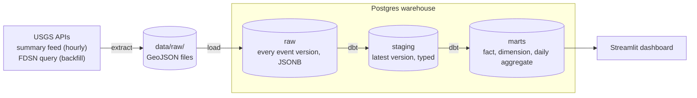

# USGS Earthquake Pipeline

[](https://github.com/mikestantonmusic/quake-pipeline/actions/workflows/ci.yml)

An ELT pipeline that batch-loads [USGS earthquake data](https://earthquake.usgs.gov/earthquakes/feed/v1.0/geojson.php) into Postgres every hour, transforms and tests it with dbt, orchestrates it with Airflow, and serves it in a Streamlit dashboard. Everything runs locally in Docker.

**Stack:** Python · Airflow 3 · Cosmos · dbt · Postgres 16 · Streamlit · Docker Compose · GitHub Actions

<!-- Screenshots: add docs/images/dashboard.png and docs/images/airflow-graph.png, then uncomment.


-->

## Highlights

- **Handles revisions correctly.** USGS revises events after publishing them (new magnitudes, `automatic` → `reviewed`, deletions). Raw storage keeps every version, keyed on `(event_id, updated_ms)`; dbt keeps the latest; deletions propagate to the marts.
- **Idempotent end to end.** Re-running any extract, load, DAG run or backfill never duplicates data, so retries and overlapping hourly feeds are safe.
- **Correct under concurrency.** Hourly runs and backfills can overlap: dbt tasks share a one-slot pool, and the incremental model uses a lookback window so a slow load's rows can't be skipped.
- **Tested at every layer.** 63 pytest tests (API client, loader, dashboard queries and pages), 27 dbt data tests including reconciliation checks against raw, and CI that runs all of it against a real Postgres.
- **One Airflow task per dbt model** via Cosmos, so a failure points at the exact model and can be retried on its own.

## Architecture



Airflow runs `extract → load → dbt` every hour (`quake_incremental`) and on demand for date ranges (`quake_backfill`). The Python extract and load code has no Airflow imports, so it also runs and is tested on its own.

## Quick start

Requires [Docker Desktop](https://www.docker.com/products/docker-desktop/).

```sh
cp .env.example .env          # PowerShell: Copy-Item .env.example .env
docker compose up -d --build  # or: make up
```

| Service   | URL                    |
|-----------|------------------------|
| Airflow   | http://localhost:8080  |
| Streamlit | http://localhost:8501  |
| Postgres  | localhost:5432 (credentials in `.env`) |

Then, in Airflow:

1. Trigger `smoke_test`. It passes when the warehouse schemas exist and dbt is installed.
2. Load some history: trigger `quake_backfill` with a start and end date (see [Orchestrating with Airflow](#orchestrating-with-airflow)).
3. Unpause `quake_incremental` to load new earthquakes every hour.

## Local development (no Docker needed)

The ingestion code is plain Python, so it can be run and tested directly:

```sh
python -m venv .venv
.venv\Scripts\activate            # macOS/Linux: source .venv/bin/activate
pip install -r requirements-dev.txt
pre-commit install                # run the linters before every commit

pytest                            # tests; database tests skip unless Postgres is running
ruff check .                      # lint Python
sqlfluff lint dbt/quake/models dbt/quake/tests   # lint dbt SQL

# Download data into data/raw/
python -m ingestion.extract feed --level all --period day
python -m ingestion.extract range --start 2026-10-01 --end 2026-10-02
```

Raw files are saved unchanged and named after the window they cover, so re-running an extract overwrites rather than duplicates:

```
data/raw/feed/all_day/YYYY/MM/DD/<run time>.geojson
data/raw/fdsn/YYYY/MM/DD/<window start>_<window end>.geojson
```

The FDSN API returns at most 20,000 events per query, so `range` checks the count first and halves the window until each part fits.

### Loading into Postgres

With the Docker stack running:

```sh
python -m ingestion.load                         # load everything under data/raw
python -m ingestion.load data/raw/fdsn/2026/10   # or specific files/folders
```

`raw.earthquake_events` stores one row per event **version**, keyed on `(event_id, updated_ms)`. USGS bumps `updated` whenever it revises an event (new magnitude, status `automatic` → `reviewed`), so revisions become new rows. Seeing the same version again, which happens constantly because the hourly `all_day` feed overlaps itself, inserts nothing. That makes loads idempotent: re-running a load never creates duplicates. Each load is recorded in `raw.load_audit`.

Database tests run against a separate `warehouse_test` database and are skipped automatically when Postgres isn't reachable.

## Transforming with dbt

dbt runs inside the Airflow container, which has it installed and can reach Postgres:

```sh
docker compose exec -w /opt/airflow/dbt/quake airflow-scheduler dbt deps    # first time only
docker compose exec -w /opt/airflow/dbt/quake airflow-scheduler dbt build   # build and test everything
```

| Table | Grain | Purpose |
|-------|-------|---------|
| `staging.stg_earthquakes` | one row per event | Latest version of every event, flattened from JSON into typed columns |
| `marts.fct_earthquakes` | one row per earthquake | Main analysis table; excludes blasts and deleted events; adds `mag_class`, `depth_class`, `region` |
| `marts.dim_region` | one row per region | Lifetime stats per region |
| `marts.agg_daily_by_region` | one row per region per day | Daily counts and magnitudes |

Design decisions:

- **Incremental staging, re-ranked per event.** Each run reprocesses every stored version of any event with new rows, not only the new rows, so an older version loaded late by a backfill can't overwrite a newer one.
- **Deletions propagate.** A version with status `deleted` removes the event from the marts while staying visible in staging.
- **Reconciliation tests.** Besides column tests, `tests/` asserts that `fct_earthquakes` matches the latest versions in raw, and that the daily aggregate adds up to the fact table.
- **`region` comes from `place`.** It's the text after the last comma, or the whole string when there's no comma ("Banda Sea"). The `region_aliases` seed expands codes like `CA` and `MX`. It's a label parsed from USGS text, not a true geographic join.

## Orchestrating with Airflow

Two DAGs run the full pipeline. Both are paused when first created; unpause them in the Airflow UI (http://localhost:8080).

| DAG | Schedule | What it does |
|-----|----------|--------------|
| `quake_incremental` | hourly | Downloads the `all_day` feed, loads new event versions, rebuilds the marts |
| `quake_backfill` | manual | Downloads a date range from the FDSN API, loads it, rebuilds the marts |

```
extract → load → transform (dbt, one task per model via Cosmos)
                   region_aliases.seed → test ─┐
                   stg_earthquakes.run → test ─┴→ fct_earthquakes.run → test ─┬→ dim_region.run → test
                                                                              └→ agg_daily_by_region.run → test
```

To backfill, trigger `quake_backfill` with a config such as `{"start": "2026-10-01", "end": "2026-10-08"}` (UTC dates, end exclusive):

```sh
docker compose exec airflow-scheduler airflow dags trigger quake_backfill --conf '{"start": "2026-10-01", "end": "2026-10-08"}'
```

Design decisions:

- **Thin DAGs.** Tasks call the same `ingestion` functions as the CLI. Only file paths and small summaries pass between tasks (XCom), never the data itself.
- **Per-model dbt tasks with [Cosmos](https://github.com/astronomer/astronomer-cosmos).** Each model and its tests are separate Airflow tasks, so a failure shows exactly which model broke and can be retried on its own. Tests use `BUILDABLE` selection, so a test that reads several models only runs once all of them are rebuilt.
- **A one-slot `dbt` pool.** All dbt tasks share it, so an hourly run and a backfill never build the same incremental table at the same time.
- **Safe retries.** Every task is idempotent: extract files are named after the run, and loads skip versions that are already stored.

## Dashboard

http://localhost:8501 has two pages:

- **Earthquakes**: date, magnitude and region filters above stat tiles, a world map (dot size = magnitude, color = depth band), earthquakes per day, the magnitude distribution, the busiest regions and the strongest events with links to USGS.
- **Pipeline health**: data freshness against the same thresholds as the dbt freshness check, hourly load coverage, new versions per load, invalid-event counts and warehouse totals.

The code is split so each layer can be tested on its own:

| File | Role |
|------|------|
| `dashboard/queries.py` | All SQL, with bound parameters; no Streamlit, so it runs in tests |
| `dashboard/metrics.py` | Pure pandas calculations (KPIs, daily counts, histogram, freshness) |
| `dashboard/charts.py` | Altair charts and the pydeck map, using a validated light/dark palette |
| `dashboard/db.py` | Connection plus 5-minute caching of every query |
| `dashboard/views/` | The two pages, layout only |

It reads only `marts.*`, plus `raw.load_audit` for health. `tests/test_dashboard.py` covers the calculations, runs the queries against `warehouse_test`, and renders both pages headlessly with Streamlit's `AppTest`.

## Testing and CI

Every push and pull request runs three GitHub Actions jobs (`.github/workflows/ci.yml`):

| Job | What it checks |
|-----|----------------|
| Lint | `ruff` on Python, `sqlfluff` on the dbt SQL |
| Python tests | The full pytest suite against a Postgres service container. `REQUIRE_TEST_DB=1` makes database tests fail rather than skip if Postgres is unreachable, so a green run means they really ran. |
| dbt | Loads the fixture events with the real loader, then runs `dbt build` twice: once from empty, once through the incremental path |

The same linters run locally before each commit through `pre-commit` (`.pre-commit-config.yaml`), pinned to the versions in `requirements-dev.txt`.

## Running it day to day

- **Shutting down:** `docker compose down` in the evening and `docker compose up -d` in the morning. There's no need to pause DAGs: each hourly run reloads the past 24 hours, so a gap shorter than a day fills itself.
- **Longer gaps** (a weekend away): trigger `quake_backfill` for the missing days. Overlapping days already loaded are skipped.
- **If the computer sleeps mid-run:** Airflow detects the frozen task on wake and retries it automatically. A run still stuck 15 minutes after waking can be marked failed in the UI; the next hourly run catches up.
- **Monitoring:** the dashboard's *Pipeline health* page shows freshness and recent loads; task-level results and logs are in the Airflow UI.

## Future work

- **Failure alerts:** notify by email, Slack or Discord when a task fails after its retries.
- **Freshness as a pipeline step:** run `dbt source freshness` in the DAG so stale data fails a run.
- **Faster dbt tasks:** each Cosmos task reinstalls dbt packages (~5 s of its ~14 s); installing them once in the image would save roughly a minute per hourly run.
- **Geographic regions:** replace the `place`-text parsing with a PostGIS join against country and ocean boundaries.
- **Retention:** clean up old raw files and Airflow logs.
- **Cloud version:** port the warehouse to BigQuery (loader and SQL dialect change; the design stays the same).

## Layout

| Path | Purpose |
|------|---------|
| `ingestion/` | Pure-Python extract and load code (no Airflow imports, unit-testable) |
| `dags/` | Airflow DAGs |
| `dbt/` | dbt project (staging and marts) |
| `dashboard/` | Streamlit app |
| `tests/` | pytest suite and fixture data |
| `docker/` | Airflow image and Postgres init scripts |
| `.github/workflows/` | CI |
| `data/` | Raw GeoJSON landing zone (git-ignored) |
